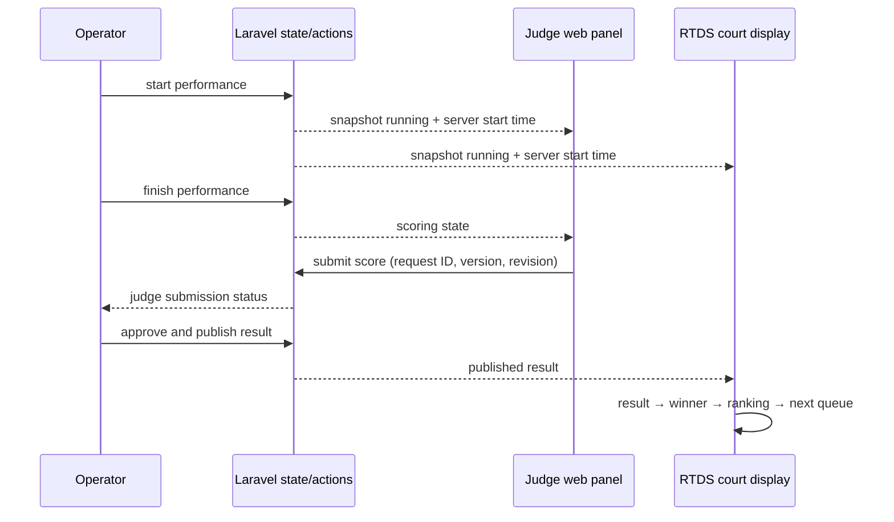

# تحویل پنل‌های مسابقه و جریان زنده

این سند رفتار پیاده‌شده در برنچ `integration/scoreboard-bf` را برای توسعه‌دهنده، مسئول سالن و تیم استقرار توضیح می‌دهد. کد سرور مالک وضعیت رسمی مسابقه است؛ صفحه‌های وب فقط وضعیت مجاز نقش خود را نمایش می‌دهند و عملیات مجاز را به سرور می‌فرستند.

## مالکیت و دسترسی

| نقش حساب | صفحهٔ اصلی | داده/عملیات |
| --- | --- | --- |
| `admin` یا `manager` | `/tournaments/{id}/setup` | مدیریت زمین، حساب‌ها، رده، ثبت‌نام، قرعه، تنظیمات و گزارش؛ صفحهٔ `/system` فقط برای این نقش است |
| `operator` | `/tournaments/{id}` | میز تک‌صفحه‌ای هر زمین، شروع/پایان اجرا، تأیید نتیجه، حل تساوی و ثبت جایگزین نمره |
| `judge` | `/tournaments/{id}/judge` | اجرای تخصیص‌داده‌شده، تایمر، فرم نمره و اصلاح مجاز نمرهٔ خودش |
| `display` | `/tournaments/{id}/rtds?court={id}` | snapshot عمومی همان مسابقه و زمین، بدون فرمان نوشتن |

`EnsurePanelRole` روی مسیرهای وب نقش را بررسی می‌کند. `User::panelRole()` حساب غیرفعال و حساب عادی با نقش‌های متفاوت در مسابقات را رد می‌کند. مدیر سراسری به پنل مدیریت می‌رود. `DashboardController` و `TournamentController::show` حساب را مستقیم به پنل خودش هدایت می‌کنند. جداسازی در UI به‌تنهایی معیار امنیت نیست؛ route، policy و action هم باید مجوز را بررسی کنند. API موبایل Sanctum و مجوزهای خودش را دارد.

مسیرهای مهم با نام route: `tournaments.setup`، `tournaments.show`، `judging.index`، `scoreboard.rtds`، `scoreboard.data` و `competition.system`. صفحه‌های مجزای فرانت‌اند نمایشگر در `/tournaments/{id}/scoreboard/{view}` فقط برای نقش `display` قابل دسترس‌اند.

## چرخهٔ یک بازی روی یک زمین

1. مدیر زمین، داوران، رده و جدول را آماده می‌کند. اپراتور در ستون چپ میز اجرا بازی‌های همان زمین را می‌بیند.
2. RTDS فهرست اجراهای بعدی را نشان می‌دهد. وقتی اجرای اول آماده باشد، RTDS پس از مکث نمایشی کوتاه به «فراخوان» می‌رود. **فراخوان یک حالت نمایشی است و اپراتور دکمه یا فرمان جداگانه‌ای برای آن ندارد.**
3. اپراتور اجرا را با فرمان `start` شروع می‌کند. وضعیت رسمی performance روی سرور `running` می‌شود. تایمر داور و مانیتور از زمان شروع ثبت‌شده روی سرور استفاده می‌کنند.
4. اپراتور `finish` را ثبت می‌کند. اجرا وارد `scoring` می‌شود؛ داورهای تخصیص‌داده‌شده نمره می‌فرستند. میز اجرا برای هر صندلی، اتصال دستگاه در حالت realtime و وضعیت ارسال نمره را جداگانه نشان می‌دهد.
5. اپراتور نمره‌ها را بررسی و با `approve` منتشر می‌کند. RTDS فقط نتیجهٔ منتشرشده را به‌عنوان نتیجه نشان می‌دهد. اگر رقابت کامل و برنده مشخص شود، صفحهٔ برنده و سپس رتبه‌بندی در صورت وجود دادهٔ رتبه ظاهر می‌شوند.
6. پس از مدت نمایش نتیجه (۶ ثانیه)، برنده (۷ ثانیه) و رتبه‌بندی (۸ ثانیه)، نمایشگر به صف و فراخوان اجرای بعدی برمی‌گردد. اگر رقابت هنوز منتظر تصمیم اپراتور باشد، صفحهٔ نتیجه تا ثبت تصمیم باقی می‌ماند. اجرای جدیدِ واقعاً شروع‌شده بر نمایش نتیجهٔ قبلی اولویت دارد.

مرحله‌های نمایشی در `resources/js/Pages/Competition/Rtds.vue` انتخاب می‌شوند و از همان UI ساخته‌شده در `resources/js/Pages/Scoreboard/{Standby,LiveBoard,Scoring,Result,Winner,Ranking}.vue` استفاده می‌کنند. انتخاب زمین با `?court=` ثابت است. نمایشگر به‌صورت خودکار routeها را عوض نمی‌کند؛ فقط کامپوننت متناظر را با snapshot همان زمین نشان می‌دهد. نتایج زمین دیگر نباید جای نتیجهٔ این زمین را بگیرند.

زمان‌های مکث UI در مرورگر حساب می‌شوند. در حال حاضر سرور «فراخوان» را به‌عنوان رویداد رسمی ثبت نمی‌کند و زمان‌بندی یکسانِ فریم‌به‌فریم بین دو مانیتور تضمین نشده است. این محدودیت مانع همگام‌بودن **وضعیت رسمی** شروع، پایان، نمره و نتیجه نیست، اما اگر نمایش کاملاً هم‌زمان چند مانیتور لازم باشد باید برای مرحلهٔ فراخوان/ارائه timestamp سمت سرور اضافه شود.

## جابه‌جایی داده بین سه پنل

پنل داور و اپراتور از `useCompetitionUpdates` برای تازه‌سازی هنگام event و از Inertia polling هر ۲ ثانیه به‌عنوان پشتیبان استفاده می‌کنند. RTDS از `useDisplayUpdates` استفاده می‌کند: event مسابقه و درخواست تغییرات بر اساس `revision`، با polling حدود ۵۰۰ میلی‌ثانیه. RTDS هنگام ردشدن دسترسی تازه‌سازی را متوقف می‌کند. snapshot عمومی در `CompetitionDisplay` ساخته می‌شود؛ دادهٔ داورهای دیگر و فرمان‌های اپراتوری به نقش نمایشگر داده نمی‌شود.

نمایش حضور فیزیکی داور به اتصال realtime/presence وابسته است. `POLLING` به معنی دریافت دوره‌ای وضعیت مسابقه است، **نه** اثبات آنلاین‌بودن تبلت. وضعیت «نمره ارسال شده» از دادهٔ سرور مستقل از presence است.

## ثبت دستی هنگام خرابی تبلت

از میز اپراتور، اجرای فعال و صندلی داور را انتخاب کنید و نمرهٔ جایگزین را با دلیل اجباری ثبت کنید. این مسیر از action مشترک با محدودیت نسخه و audit استفاده می‌کند. نمره تا تأیید اپراتور به نتیجهٔ رسمی RTDS تبدیل نمی‌شود. پس از بازگشت تبلت، نسخهٔ قدیمی نباید بتواند نمرهٔ ثبت‌شدهٔ جدید را بی‌صدا بازنویسی کند؛ برای این رفتار تست‌های `ProxyScoringTest` و `ProxyScorePublicationTest` وجود دارند.

## فایل‌های راهنما برای توسعه

| بخش | نقطهٔ شروع |
| --- | --- |
| جداسازی نقش‌ها | `app/Http/Middleware/EnsurePanelRole.php`، `app/Models/User.php`، `routes/web.php` |
| snapshot اپراتور | `app/Actions/CompetitionConsole.php` |
| snapshot نمایشگر | `app/Actions/CompetitionDisplay.php` و `app/Actions/CompetitionView.php` |
| داور وب | `resources/js/Pages/Competition/Judge.vue` و `resources/js/Components/competition/judge/` |
| میز اپراتور | `resources/js/Pages/Competition/Console.vue` و `resources/js/Components/competition/operator/` |
| RTDS | `resources/js/Pages/Competition/Rtds.vue` و `resources/js/Pages/Scoreboard/` |
| ادمین | `resources/js/Pages/Tournaments/Show.vue` و `resources/js/Pages/Competition/System.vue` |

## راه‌اندازی و تأیید قبل از مسابقه

1. در نصب تازه `.env`، کلید برنامه، دیتابیس، URL قابل دسترس از LAN و HTTPS را تنظیم کنید. `php artisan migrate --force` را در روند استقرار اجرا کنید. این برنچ migration عضویت نقش `display` در `tournament_user` دارد؛ قبل از بازگرداندن migration روی دادهٔ واقعی نقش‌های نمایشگر را بررسی کنید.
2. اگر از Mercure استفاده می‌کنید، hub، secret و originهای مجاز را طبق [راهنمای realtime](android-realtime-integration.md) تنظیم کنید. worker صف را جداگانه پایدار نگه دارید. `APP_DEBUG=false` باشد؛ secret را در متغیرهای `VITE_` قرار ندهید.
3. `composer install --no-dev --optimize-autoloader`، `npm ci` و `npm run build` را در محیط مناسب اجرا کنید. تنظیم DB/queue/cache را از صفحهٔ ادمین `/system` ببینید. برچسب `configured` برای Mercure به معنی آزمون واقعی اتصال دستگاه نیست.
4. روی یک مسابقهٔ آزمایشی با حساب‌های جداگانهٔ مدیر، اپراتور، داور و نمایشگر وارد شوید. از دو دستگاه داور، مانیتور RTDS همان زمین و میز اپراتور یک اجرای کامل را انجام دهید. قطع و وصل شبکه، retry نمره، ثبت جایگزین، تأیید نتیجه، برنده و بازگشت به صف را بررسی کنید.
5. پیش از روز مسابقه از دیتابیس backup بگیرید و restore را روی محیط جدا آزمایش کنید. زمان سرور، مرورگرها و دستگاه‌ها را همگام کنید.

تست خودکار این برنچ با `php artisan test --compact`، فرمت PHP با `php vendor/bin/pint --dirty --format agent` و فرانت‌اند با `npm run build` بررسی می‌شود. تست چند دستگاهی و پیکربندی واقعی سالن همچنان کار عملیاتی قبل از دیپلوی هستند. مخزن Android جداگانه (`mrnorouzi0001/PoomsaeScoring`) در این تحویل build یا اجرا نشده است؛ پایلوت سریع فعلی از پنل وب داور استفاده می‌کند.
