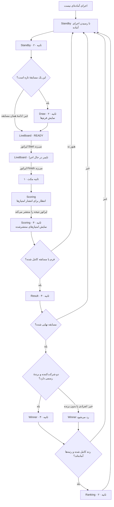
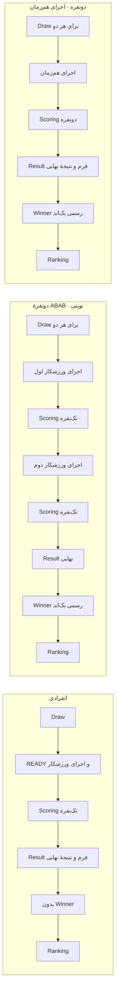

# راهنمای سریع جریان مسابقه در RTDS

این صفحه نشان می‌دهد نمایشگر هر زمین چه مسیری را طی می‌کند، هر صفحه برای چیست و کدام تفاوت‌ها به نوع مسابقه بستگی دارد. جزئیات پیاده‌سازی در [Rtds.vue](../resources/js/Pages/Competition/Rtds.vue) و صفحه‌های `resources/js/Pages/Scoreboard/` است.

## مسیر اصلی

`Standby` وقتی اجرای آماده‌ای وجود ندارد منتظر می‌ماند. پس از پایان هر بخش نتیجه، مسیر به Standby برمی‌گردد. اگر اجرای بعدی برای bout تازه باشد Draw می‌آید؛ اگر اجرای بعدی ادامهٔ همان bout باشد Draw تکرار نمی‌شود.

## سه نوع مسابقه در یک نگاه

| نوع مسابقه | جدول Scoring | Winner نهایی |
|---|---|---|
| انفرادی | تک‌نفره | ندارد؛ یک شرکت‌کننده را برنده اعلام نمی‌کنیم. |
| ABAB، اجرای نوبتی | تک‌نفره برای هر اجرا | فقط پس از پایان bout و با `winner_entry_id` بک‌اند. |
| اجرای هم‌زمان | دونفره برای هر دو اجراکننده | فقط پس از پایان bout و با `winner_entry_id` بک‌اند. |

در ABAB هر ورزشکار جدا اجرا می‌کند؛ بنابراین جدول دونفره نباید استفاده شود. در اجرای هم‌زمان، امتیاز هر دو ورزشکار در یک مرحله منتشر می‌شود و جدول دونفره مناسب است.

## زمان هر صفحه

| صفحه / وضعیت | مدت |
|---|---:|
| Standby پیش از اجرای آماده | تا وقتی دادهٔ اجرای آماده برسد |
| Standby با اجرای آماده | ۲۰ ثانیه |
| Draw برای bout تازه | ۲۰ ثانیه |
| LiveBoard / READY | بدون زمان ثابت؛ تا Start اپراتور |
| LiveBoard / تایمر | تا پایان اجرا؛ تایمر از زمان‌های بک‌اند پیروی می‌کند |
| فاصلهٔ بعد از Finish | ۱۰ ثانیه |
| Scoring پیش از انتشار | تا وقتی نتیجه منتشر شود |
| Scoring بعد از انتشار | ۳۰ ثانیه از `result_published_at` |
| Result فرم یا bout | ۳۰ ثانیه |
| Winner رسمی | ۳۰ ثانیه |
| Ranking پس از تکمیل رده و آماده‌شدن رتبه‌ها | ۲۰ ثانیه |

اگر مدت‌ها باید تغییر کنند، مقدارهای `phaseDurations` در [Rtds.vue](../resources/js/Pages/Competition/Rtds.vue) را تغییر دهید؛ واحد همه مقدارها میلی‌ثانیه است. READY، تایمر و پایان اجرا با دکمه‌های اپراتور یا زمان‌های ثبت‌شدهٔ بک‌اند کنترل می‌شوند.

## هر صفحه چه می‌کند؟

| صفحه | معنی ساده |
|---|---|
| **Standby** | چه کسی اجرا کرده، چه کسی نوبتش است و چه کسی بعد از اوست. |
| **Draw** | هر شرکت‌کننده در هر فرم چه چیزی را اجرا می‌کند. |
| **LiveBoard / READY** | ورزشکارها آماده شوند؛ مسابقه هنوز شروع نشده. |
| **LiveBoard / تایمر** | اجرا در جریان است؛ اپراتور شروع و پایان را کنترل می‌کند. |
| **Scoring** | امتیاز داورها و جمع امتیاز؛ تا انتشار، امتیاز تأییدنشده نباید نمایش داده شود. |
| **Result** | امتیاز یک فرم یا جمع‌بندی نتیجهٔ bout. |
| **Winner** | برندهٔ رسمی که بک‌اند اعلام کرده است؛ فرانت‌اند خودش برنده تعیین نمی‌کند. |
| **Ranking** | رتبه‌های دسته؛ اگر هنوز داده‌ای نرسیده باشد پیام نبود رتبه‌بندی نمایش داده می‌شود. |

## مواردی که هنوز باید روشن شوند

این‌ها نقص توضیح نیستند؛ محدودیت‌ها یا سؤال‌هایی هستند که باید با دادهٔ واقعی یا تیم بک‌اند نهایی شوند.

1. **ABAB بین دو اجرا:** فعلاً Result فرم وقتی فعال می‌شود که نتیجهٔ همان فرم برای همهٔ entryهای bout تأیید شده باشد. پس از امتیاز ورزشکار اول، Scoring تک‌نفره را می‌بینیم، اما Result جداگانه پیش از اجرای ورزشکار دوم تضمین نشده است. باید مشخص شود آیا هر اجرای ABAB باید Scoring و مکث/Result مستقل داشته باشد.
2. **مسابقهٔ دو‌راندی:** اگر دو راند در بک‌اند دو bout جدا هستند، قرارداد فعلی RTDS ممکن است برای Winner کلی کافی نباشد. لازم است بک‌اند نتیجهٔ کلی matchup، شناسهٔ boutهای مربوط و برندهٔ رسمی را یکجا به نمایشگر بدهد.
3. **هم‌زمانی چند نمایشگر:** شروع زمان Standby از وقتی است که همان مرورگر اجرای آماده را می‌بیند. برای یکسان‌شدن زمان همهٔ نمایشگرها، بک‌اند باید timestamp مشترکی مثل `ready_at` بدهد.
4. **پایان Scoring:** RTDS اولویت را به وضعیت جاری `scoring` می‌دهد. تأیید شود که بک‌اند پس از انتشار از این وضعیت خارج می‌شود؛ در غیر این صورت صفحه می‌تواند بیش از ۳۰ ثانیه بماند.
5. **Winner هر فرم:** در حال حاضر فقط Winner نهایی bout داریم. اگر بعد از هر فرم هم Winner لازم است، باید تصمیم گرفته شود و نتیجهٔ رسمی آن از بک‌اند برسد.
6. **Ranking در knockout:** فقط پس از تکمیل کل رده و دریافت `placements` نمایش داده می‌شود؛ بعد از رقابت مقدماتی، رتبه‌بندی موقت نمایش داده نمی‌شود.
7. **تساوی و تصمیم سرداور:** بک‌اند باید بعد از تصمیم، وضعیت نهایی bout و `winner_entry_id` رسمی را منتشر کند. رفتار نمایشگر تا زمان این تصمیم باید با تیم مشخص شود.

## چک‌لیست تست تیمی

برای هر سه نوع مسابقه، این مراحل را به‌ترتیب بررسی کنید:

1. وقتی اجرای آماده‌ای نیست، نمایشگر روی **Standby** بماند.
2. با آماده‌شدن مسابقهٔ تازه، **Standby** به‌مدت ۲۰ ثانیه و سپس **Draw** به‌مدت ۲۰ ثانیه نمایش داده شود.
3. پس از آن، صفحهٔ **READY** تا شروع اپراتور بماند. با شروع مسابقه، تایمر حرکت کند.
4. پس از زدن **Finish**، ۱۰ ثانیه صبر شود و بعد صفحهٔ **Scoring** نمایش داده شود.
5. پس از انتشار امتیازها، جدول درست و نتیجهٔ مسابقه نمایش داده شود.
6. در مسابقهٔ نهایی دونفره، **Winner** و سپس **Ranking** نمایش داده شوند. در مسابقهٔ انفرادی، صفحهٔ **Winner** نمایش داده نشود.
7. پس از پایان مراحل، نمایشگر به **Standby** برگردد.

در **ABAB**، امتیاز هر ورزشکار باید جداگانه و در جدول تک‌نفره نمایش داده شود. در اجرای **هم‌زمان**، امتیاز هر دو ورزشکار باید در جدول دونفره بیاید.
